<div align="center">

# Infinitex

**Procedural materials for three.js that never run out of detail.**
Zoom from a whole object down to microns: every matter shows a new level of structure at each step.

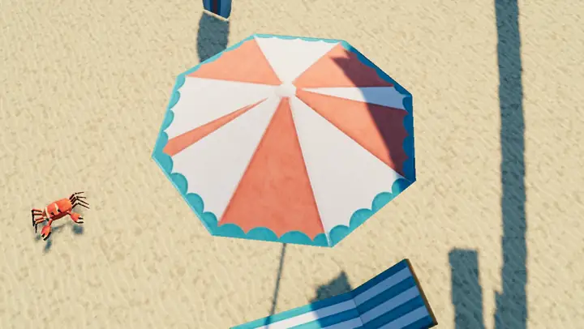

*A folded paper parasol on a tropical beach, from 3 metres away down to 2.5 mm: the painted stripes stay soft, the paper's fibres come out. No texture, nothing tiles, nothing blurs.*

**[Live demo](https://lejrimostfa.github.io/infinitex/)** (desktop browser with WebGPU; phones are too slow for now)

[](https://threejs.org) [](#browser-support) [](LICENSE) [](docs/materials.md)

</div>

---

## Why

A texture is a photo glued on a surface. Get close and you see its pixels; get far and it repeats. Infinitex computes the matter instead, from what it is made of: a knit is stitches made of plies made of fibres with cuticle scales; a board is growth rings, vessels and cell walls; lava is a crust that cracks over a glowing melt. The renderer measures how big a pixel is on the surface, and each level of structure appears when it becomes visible and fades away when it gets too small. So the same material is right on a whole character and under a macro lens.

## Gallery

| | |
|:---:|:---:|
| 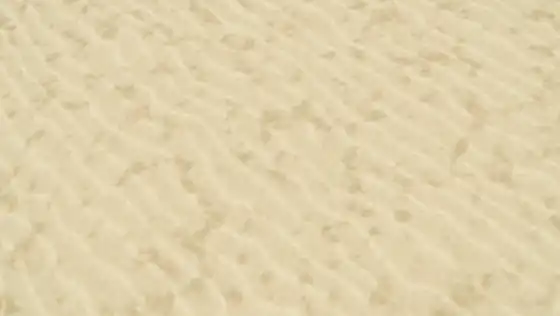<br>**Paper beach**: beach sand, grain by grain (0.35 mm) | 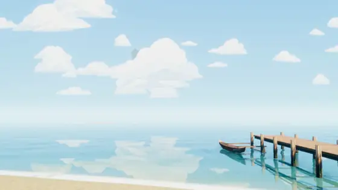<br>**Paper beach**: a 3 km paper flagship, its shadow over the bay |
| 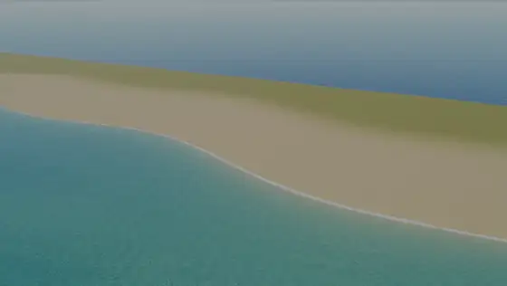<br>**Paper beach**: papercraft props, painted and folded, in Infinitex paper | 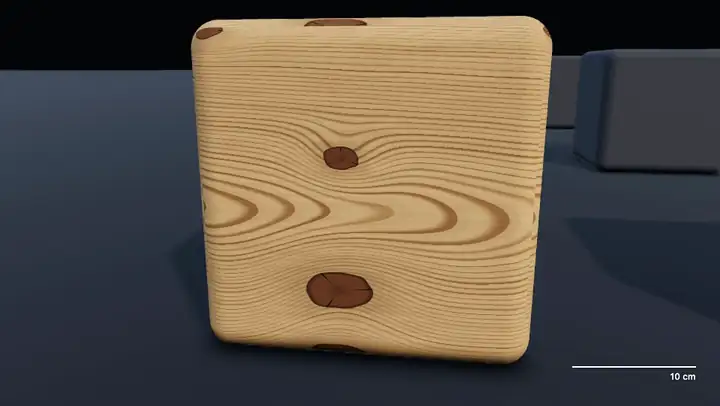<br>**Wood**: growth rings, vessels, fibres (45 cm to 1 mm) |
| 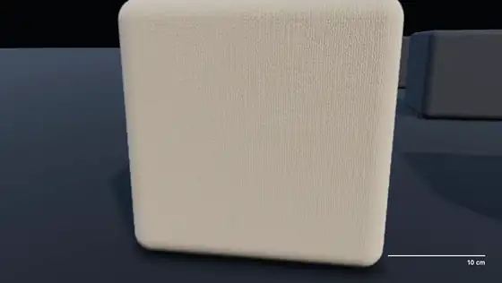<br>**Knit**: garment, stitches, plies, fibres with scales | 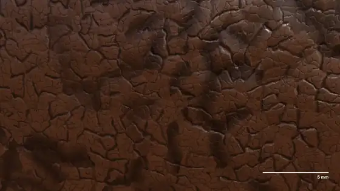<br>**Leather**: creases, pores, the cells of the finish |
| 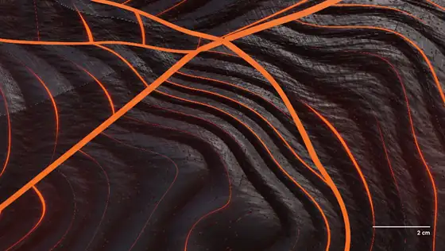<br>**Molten matter**: ropy pahoehoe crust over a 1400 K melt | 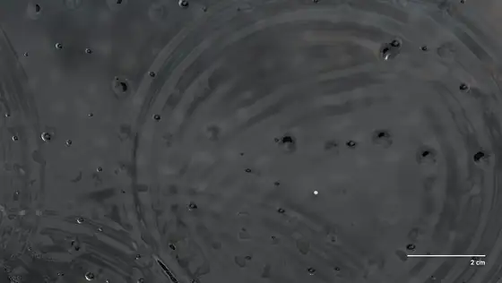<br>**Liquids**: rain rings with capillary ripples |
| 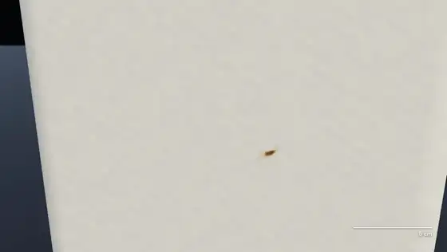<br>**Processes**: a sheet of paper burning | 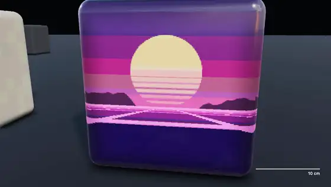<br>**CRT screen**: picture, beam lines, slot mask, phosphors |
| 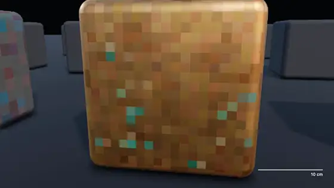<br>**Pixel art mode**: texels split as you zoom, for any matter | 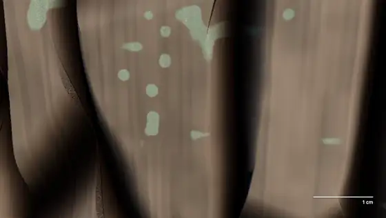<br>**Relief up close**: parallax and self shadows (bark) |
| 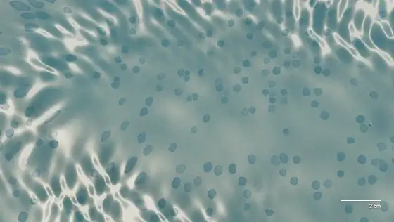<br>**Caustics**: the net of light on a pool floor | 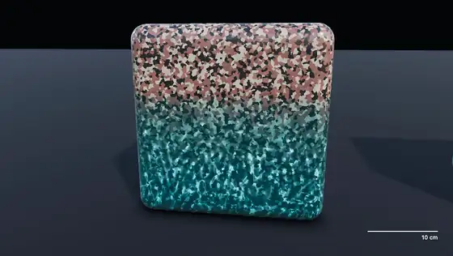<br>**Under water**: any matter, absorbed with depth |
| 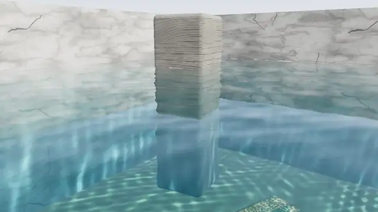<br>**Aquarium**: a dive through the surface (Snell's window, total internal reflection) | 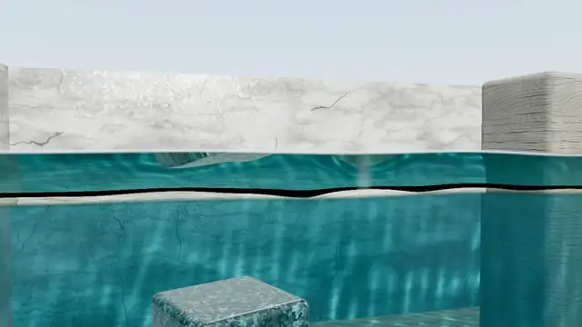<br>**Waterline on glass**: the meniscus mirrors the water below |

All clips are real-time renders of the demos in this repo (WebGPU, Chrome).

## Quick start

You need [Node.js](https://nodejs.org) 20 or later and a browser with WebGPU (Chrome or Edge 113+, Safari 26+). WebGL2 works too (`?webgl`).

```bash
git clone https://github.com/lejrimostfa/infinitex.git
cd infinitex
npm install
npm run dev
```

Or try it without installing anything: [knit](https://lejrimostfa.github.io/infinitex/character.html), [all matters](https://lejrimostfa.github.io/infinitex/cubes.html), [water](https://lejrimostfa.github.io/infinitex/aquarium.html), [living room](https://lejrimostfa.github.io/infinitex/livingroom.html), [paper beach](https://lejrimostfa.github.io/infinitex/beach.html). Locally, open http://localhost:5211/cubes.html: one rounded cube per matter, one row per family. Orbit with the mouse, scroll to zoom, and get as close as you like.

| Demo | What it shows |
|---|---|
| `cubes.html` | The whole catalogue. `?family=10` builds one row only (much faster to load), `?fly` plays a flyover, `?env=room` swaps the sky for a studio light. |
| `aquarium.html` | A tank of clear water. `?view=above`, `below`, `floor`, `glass` (the waterline through the pane) or `lens` (a camera half in the water). |
| `character.html` | The Knit page: the riveraine, a game character whose atlas-textured clothes become knit and leather, a bronze mask and a hemp rope (`demo/charbuild.js`). Its picker also opens `index.html`, the knitted concept mannequin. |
| `livingroom.html` | Ten matters in one scene: an 80s room at sunset over a lava lake (wood strips, plaster, a knotted rug, beige plastic, a CRT, leather, oranges, the lava, a photosphere sun), and the riveraine at the window. The lava lake lives: slow, thick, glowing bubbles swell on it; most burst into heavy blobs of lava that fall back in slow rings (`demo/lavafx.js`, `src/families/molten/ripples.js`, `?nolavafx`). `?view=room`, `window`, `tv`, `fruit`, `rug` or `chair`. Geometry built by code in Blender: `blender/livingroom.py`. |

The demos focus like a camera: the depth of field follows the object near the screen centre, the sharp zone shrinks as it comes close, and under 12 cm from the surface at the centre the field of view narrows to a macro lens (F or `?nodof` turns it off). Ambient occlusion acts inside the lighting and the sun casts its shadows in three cascades that follow the focus. Under water the camera port sways and softens (`src/core/underlens.js`); the suspended specks float in the water itself (`src/core/snow.js`). The aquarium has the same occlusion and depth of field, applied after its waterline. Its sand floor is displaced for real: `displace: 1` in a preset moves the vertices by the family's own height (sand ripples and mounds so far), and the normals keep the same slope. Its water shows the sun's light shafts, marched through the same waves as the caustics (`src/core/shafts.js`), and strings of rising bubbles (`src/core/bubbles.js`). Its life is built by code, no model file (`demo/sealife/`): a school of fish in the fish-scale matter that swim by a wave in the vertex stage, jellyfish that beat, and a crab in the crab-shell matter that walks sideways.

In every demo page: arrows or ZQSD (WASD on QWERTY) to walk along the view direction, Space and C to rise and sink, Shift to go faster, a click on an object to glide to it. The camera slows down near a surface and stops 0.1 mm from it, so it never goes through. It also slows down beside a surface: a strafe or a slide along the floor or a wall is as slow as a walk toward it. All of it is the camera kit below (`src/camera/`).

Every page has a tiny vehicle: a tiger mosquito 6 mm long by the riveraine's knit sleeve on Knit (and by the concept mannequin), a toy helicopter on All matters, landed on a cube, a honeybee over the fruit bowl in Room, and a toy submarine in the Water tank. Press V (or the Fly button) to board it. Space and C go up and down, Z and S (W and S on QWERTY) dip or raise the nose, Q and D (A and D) move sideways, the arrows move forward and back and turn, Shift steps the top speed: slow, medium, fast, then slow again (the hint shows it). Drag to look around, scroll for the camera distance. On a phone or a tablet the Fly button sits at the top right; while flying, the left stick moves and turns (as the arrows), the right stick sets the nose and moves sideways, buttons go up and down, and a speed button steps slow, medium, fast. With no key held it hovers in place. Its speed follows the room ahead, so it crawls along a stitch. The insects' eyes are the Infinitex insect eye, the bee's thorax wears 700 real hairs, the helicopter wears two of the wall's plastics, the submarine four plastics made for water: caustics, colour loss and refraction through the surface, like the rest of the tank. It stays under the water. A surface that moves into a vehicle (an animated arm) pushes it back out instead of swallowing it (`demo/flyer.js`, `demo/vehicles/`).
| `index.html` | A knitted mannequin with sliders, live stats and a "level view" that colours each level of detail. |

## Use it in your scene

```js
import * as THREE from 'three/webgpu';
import { uv } from 'three/tsl';
import { createMaterial } from './src/index.js';

const geometry = new THREE.BoxGeometry( 0.3, 0.3, 0.3 );
geometry.computeTangents();                      // the families need tangents

const ix = createMaterial(
	{ family: 'wood', intent: 'driftwood', weather: 1, checks: 0.6 },
	{ coords: uv().mul( 0.3 ) }                   // surface coordinates in metres
);
scene.add( new THREE.Mesh( geometry, ix.material ) );
```

Three things to know:

1. **Coordinates are metres on the surface.** Pass `coords` (a TSL `vec2` node), usually your UVs times the size of the UV square in metres. Use the same scale in u and v. Real sizes are what make a stitch 3 mm wide and a fibre 15 um thick.
2. **`ix.material` is a normal three.js node material** (`MeshPhysicalNodeMaterial`, or a subsurface one for skin and marble). Lights, shadows, environment and post-processing work as usual.
3. **Change parameters live** with `ix.set( { ... } )`. It only updates uniforms: no recompile. Structural switches (a family's `mode`, `pixel`, `relief`) are read when the material is built.

```js
ix.set( { wetness: 0.7, wear: 0.3 } );                         // shared surface states
ix.addEventListener( 'paramsChanged', ( e ) => console.log( e.detail.preset ) );
const fuzz = ix.createFuzz( mesh );                            // knit and cloth: fibre shells
const hair = ix.createHair( mesh, { metersPerUV: 0.3 } );      // skin, fur, pile: 3D strands
```

Events: `materialReady` once, `paramsChanged` after each `set()`, `fuzzAttached` after `createFuzz()`. Each carries `{ family, preset, stats, derived }`.

### Presets

A preset is a plain object: `family`, an optional `mode`, then real-world parameters (sizes in `_mm` or `_um`, colours as hex strings). Every family's defaults and slider ranges are exported:

```js
import { families } from './src/index.js';
console.log( Object.keys( families ) );          // ['knit', 'skin', 'metal', ...]
console.log( families.metal );                   // every metal parameter with its default
```

The 241 presets of the cube wall (`demo/cubelist.js`) are ready-made starting points: copy one and change what you need. English names and captions are in `demo/cubelist_en.js`.

### Layers on top of any preset

| Key | What it adds |
|---|---|
| `wetness`, `gloss`, `wear` | Shared surface states: soaked and darker, varnished, polished tops and dirty hollows. |
| `dusty`, `muddy`, `rusty`, `frosted`, `burnt`, `greasy`, `sweaty`, `bloody` | More states, 0 to 1, each with its colour and size (`dusty_color`, `rusty_mm`...): see `src/core/states.js`. |
| `pixel: 1` | Pixel art. Texels are a power of two in metres; zoom in and each one splits into four. `pixel_px` sets their size on screen. |
| `relief: 1` | Real relief up close (parallax occlusion with self shadows) for families with a height (wood, water). Free when far away. |
| `underwater: 1` | Below the scene's water level: caustics, colour lost with depth, haze (`waterBody` in `src/core/underwater.js`). |
| `micro: 0` | Turns off the micro detail that carries on under each family's finest level, down to 1 um. `micro: 2` doubles it. |

### Water, mirrors and the waterline

The water tools are scene-level helpers, used by `demo/aquarium.js`:

```js
import { waterBody } from './src/core/underwater.js';
import { createWaterSurface, daySky } from './src/core/watersurface.js';
import { createMirror } from './src/core/mirror.js';
import { createWaterline } from './src/core/waterline.js';

waterBody.level.value = 0.35;                                   // world height of the still water
const sky = daySky( sunDirectionNode );
const tank = new THREE.ClippingGroup();                         // what the mirrors may cut at the level
const mirrors = { up: createMirror( { group: tank, level: 0.35, side: 1 } ), down: createMirror( { group: tank, level: 0.35, side: - 1 } ) };
const water = new THREE.Mesh( new THREE.PlaneGeometry( 1.2, 0.8 ), createWaterSurface( sky, mirrors ) );
const line = createWaterline( renderer, scene, camera, { glassZ: 0.4, prepare: ( c ) => { mirrors.up.render( renderer, c ); mirrors.down.render( renderer, c ); } } );
// each frame: line.render();
```

## Camera kit

The demos' camera is a library too: `infinitex/camera`. Walk keys, collisions that stop 0.1 mm from any surface (BVH, skinned characters included), a macro lens with depth of field focused on what the camera aims at, ambient occlusion inside the lighting, sun shadows in cascades that follow the focus, and adaptive resolution. Each part can be turned off.

```js
import { createCameraStage, createCameraKit } from 'infinitex/camera';

const { renderer, camera, controls } = await createCameraStage();   // reversed depth, near 1 um
const kit = createCameraKit( { renderer, scene, camera, controls, options: { dof: true, macro: true } } );
kit.addEventListener( 'macroChanged', ( e ) => console.log( 'macro', e.detail.macro ) );
renderer.setAnimationLoop( () => { kit.update( 1 / 60 ); kit.render(); } );
```

With your own renderer: create it with `{ ...RENDERER_OPTIONS }` (reversed depth) and call `applyCameraSettings( { renderer, camera, controls } )`. Options, events, measured costs and traps: [docs/camera.md](docs/camera.md).

## Make your own material

First try a preset: most matters are one of the 241 ready presets with other sizes and colours. When no family has the structure of your matter, add one. It behaves like a built-in one: same zoom, same events, same checks.

```bash
npm run new-family -- cork            # in this repository: src/families/cork, from the terrazzo template
npm run check-family -- src/families/cork
npx infinitex-new-family cork         # in a game that installed Infinitex: ./families/cork
npx infinitex-check families/cork     # lint, quality gate, frame cost, contact sheet, WebGPU and WebGL2
```

```js
import { registerFamily, createMaterial } from 'infinitex';
import cork from './families/cork/index.js';
registerFamily( 'cork', cork );       // validated, emits familyRegistered on familyEvents
const ix = createMaterial( { family: 'cork' }, { coords: uv().mul( 0.3 ) } );
```

A liquid in any closed container (a glass, a bottle, a vat), with meniscus, ripples, refraction and absorption by depth:

```js
import { createLiquidVolume, thinGlassMaterial } from 'infinitex';
const wine = createLiquidVolume( { cavity: new THREE.LatheGeometry( innerProfile, 96 ), fill: 0.55, liquid: 'wine' } );
glassMesh.add( wine.object );
```

The rules (footprint, fades, real branches, roughness from faded slopes), the measured numbers, the non-opaque kinds and the limits: **[docs/authoring.md](docs/authoring.md)**. See it at `check.html?family=/src/families/terrazzo/index.js` and `check.html?volume=1`.

**Claude Code skill.** `.claude/skills/infinitex-material/` makes Claude follow this workflow when you ask for a material ("make me a cork material", "fais-moi un matériau", "fill this bottle with honey"). In a game project, copy that folder into your own `.claude/skills/`: `cp -r node_modules/infinitex/.claude/skills/infinitex-material .claude/skills/`. The check needs `npm i -D vite playwright-core` and a Chromium (`npx playwright install chromium`).

## How it works

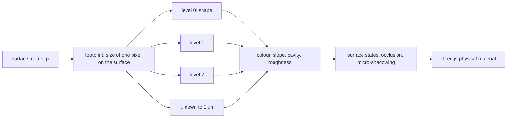

- **Footprint.** At the top of every material, screen derivatives give the size of one pixel in surface metres (`src/core/lod.js`).
- **Fade in, never pop.** A level of period *P* appears between 2 and 6 pixels per period (`fadeIn`). Below that it would alias, so it fades out and hands its slope variance to the roughness (Toksvig, LEAN). Far away, a fabric keeps the sheen of the fibres you can no longer see.
- **No textures.** Everything comes from hashes, value noise, Voronoi cells and analytic shapes. Cell ids are hashed modulo 4096 and coordinates folded around 0 (`wrapCoord`), so patterns are exact and seamless anywhere in space, negative coordinates included.
- **Light.** Each family reports a cavity signal. It becomes ambient and specular occlusion, and micro-shadowing for the key light (Chan 2018), so a pore or a crack darkens like a real one.
- **Reproducible time.** Animated matters (lava, water, burning paper) read one clock, `ixTime`. Films render frame by frame and come out the same every time.

## The catalogue

26 families, 241 presets. Full descriptions, level by level, with real sizes: [docs/materials.md](docs/materials.md).

| Family | Examples |
|---|---|
| Knit | jersey, rib, cables, crochet, lace, fleece, knit from a game texture |
| Woven | linen, denim, silk satin, tweed, herringbone |
| Pile and velvet | carpets, velvet, corduroy, terry towelling, knotted rug |
| Non-woven | felt, boiled wool, paper, corrugated cardboard, papier-mâché |
| Basketry and braiding | wicker, raffia, bamboo, caning, tatami, rope |
| Leather | full-grain, cracked, patent, wet, suede, crocodile |
| Human skin | many tones, face, lips, palm prints, with pores and peach fuzz |
| Animal skin | elephant, rhinoceros, whale, snake, shark |
| Hair and feathers | hair, fur, feathers, raw fleece (3D strands up close) |
| Wood | rough-sawn, varnished, painted and peeling, driftwood, charred, plywood, chipboard, cork, bark |
| Metal | hammered bronze, copper patina, brass, gold, rust, brushed steel, chrome, painted |
| Stone and building | granite, marble, sandstone, slate, concrete, brick |
| Soils and grains | soil, sand, gravel, cracked mud, snow, frost |
| Plant | leaf, moss, mushroom, bone, horn, nacre |
| Plastics | moulded, glossy, matt, yellowed, rubber, silicone, foam |
| Ceramics and glass | crackle porcelain, faience, terracotta, frosted and blown glass, enamel |
| Surface states | wet, varnished, worn, dust, mud, burnt |
| Painted and decorated | oil paint, embroidery, screen print, tattoo |
| Science fiction | flake paint, opal, hologram, iridescent foil, liquid crystals, LCD and CRT screens |
| Organic | petals, fruit skins, bread crust, coral, barnacles, mould and dozens more |
| Molten matter | pahoehoe and aa lava, lava lake crust, embers, molten steel, slag |
| Liquids and films | water over sand, rain on a puddle, running water, oil slick, soap film, sea foam |
| Transformations | burning paper, frost forming, melting ice, spreading rust and ink, drying paint, mould |

## Performance

Infinitex trades memory for computation: it stores no images, so the GPU recomputes the matter for every pixel. Measured on an Apple M1 Max at 1920x1080 ([details](docs/performance.md)):

| | Infinitex | Classic textures |
|---|---|---|
| A small game scene (character in 5 matters, set in 8) | about 10 ms per frame | about 3 ms |
| One matter filling the screen, median of the catalogue | 2 to 3.5 ms | under 1 ms |
| Texture memory for those 13 matters | 0 MB (plus about 185 MB of compiled shaders) | 870 MB at 2K (220 MB compressed) |

The demos lower their pixel ratio while frames are slow (Retina screens shade 4 times more pixels) and raise it back when they are fast; `?fullres` turns that off. A stats panel at the top left gives fps, frame and GPU time, triangles and draw calls.

Estimates for other machines: about 40 fps on a recent MacBook Air, 100 to 140 fps on a PC with an RTX 3060. Phones are not playable yet. The practical recipe for a game: Infinitex on what is close (the hero, the ground at their feet, the object being inspected), and a texture baked from the same material for the distance.

## Browser support

WebGPU first (Chrome and Edge 113+, Safari 26+, Firefox with WebGPU enabled), WebGL2 as a fallback through three's `WebGPURenderer` (`?webgl` in the demos). The demos use a reversed depth buffer, so a camera can sit 1 um from a surface.

## Project layout

```
src/
  index.js            createMaterial, the family table
  core/               level of detail, hashes, noise, Voronoi, surface states, micro detail,
                      occlusion, pixel art, relief, caustics, water, mirrors, waterline, clock
  families/<name>/    params.js (preset -> uniforms) and the TSL graph, split by level or mode
demo/                 cube wall, aquarium, living room, paper beach, mannequin, flyover, post-processing
blender/              Blender scripts that build demo geometry (livingroom.py)
docs/                 catalogue, references, performance, benchmark data
tests/                headless quality gate, benchmarks, film recorder (Playwright)
```

Record a film of any demo frame by frame: `node tests/film.mjs out.mp4 auto` with the dev server running (`IX_URL` picks the page), or a scripted showcase with `node tests/reel.mjs tests/reels/beach.mjs beach.mp4`.

## References

Infinitex stands on published work: filtering of normals and specular anti-aliasing, hair scattering, micro-shadowing, hash functions, spectral fits, water waves and optics, absorption data and more. Every method, model and data source is listed with its paper, year and DOI, and where the code uses it: **[docs/references.md](docs/references.md)**.

## Credits

- Paper beach: the props are papercraft, folded in Blender from dielines painted with OpenAI image models ([Origami-3Dfolder-ai](https://github.com/lejrimostfa/Origami-3Dfolder-ai)), then dressed in Infinitex paper.
- Sky: [Kloppenheim 06](https://polyhaven.com/a/kloppenheim_06) by Greg Zaal, [Poly Haven](https://polyhaven.com), CC0.
- Built on [three.js](https://threejs.org) (MIT) and its TSL node system, served by [Vite](https://vitejs.dev), tested with [Playwright](https://playwright.dev).
- Written with the help of Claude (Anthropic).

## License

MIT, see [LICENSE](LICENSE).
