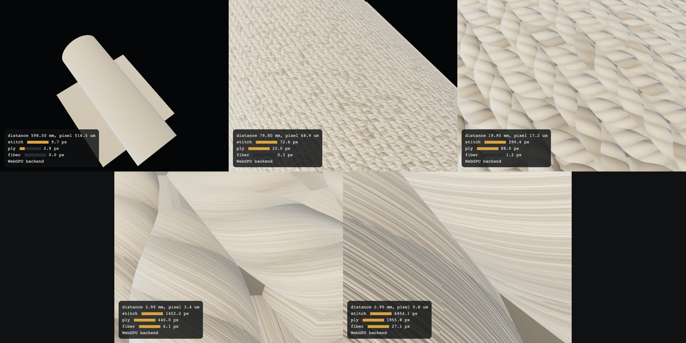

# Infinitex

Procedural three.js materials whose detail grows as the camera zooms in. From a whole object down to microns, every matter shows a new level of structure at each zoom: a knit sweater becomes stitches, then plies, then fibres with their cuticle scales; a board becomes growth rings, then vessels, then cell walls.

TSL node materials for three.js r187, WebGPU first with a WebGL2 fallback. No textures: everything is computed, so there is nothing to tile and nothing to blur.



## What is in it

- **Footprint level of detail** (`src/core/lod.js`): each level fades in when it spans a few pixels and hands its slope variance to the roughness when it fades out, so far views keep the near look and nothing shimmers.
- **26 families, more than 230 matters** (`src/families/`, catalogue in [docs/materials.md](docs/materials.md)): knit, leather, skin, metal, wood, stone, ceramic, plastic, ground, fibres, organic matter, plants, sci-fi surfaces, liquids, molten matter, processes over time (burning paper, frost, rust, drying paint) and more.
- **Micro detail** under every family's finest level, down to 1 um (`src/core/micro.js`).
- **Light**: cavity occlusion and micro-shadowing for every family (`src/core/surface.js`, `src/core/microshadow.js`).
- **Relief up close**: parallax occlusion with self shadows, gated by the footprint (`src/core/relief.js`).
- **Pixel art mode** for any matter: texels that split as you zoom in (`src/core/pixel.js`), and a CRT screen.
- **Water**: caustic nets from the ripple curvature, any matter under water (absorption, caustics), a water surface seen from both sides (Snell's window, total internal reflection), planar mirrors, and the waterline on glass with its meniscus (`src/core/caustics.js`, `underwater.js`, `watersurface.js`, `mirror.js`, `waterline.js`).
- A shared animation clock, so films render frame by frame and reproduce exactly (`src/core/clock.js`).

## Run the demos

```bash
npm install
npm run dev
```

Then open, on the dev server (port 5211):

- `cubes.html`: one rounded cube per matter, one row per family. `?family=N` builds one row; `?fly` plays the flyover; `?env=room` uses three's studio light instead of the sky.
- `aquarium.html`: a tank of clear water. `?view=above`, `below`, `floor`, `glass` (the waterline through the pane) or `lens` (a camera half in the water).
- `index.html`: a knitted mannequin with sliders, stats and the level view.

The `character.html` demo needs a rigged game character that is not included.

## Use

```js
import { createMaterial } from './src/index.js';

const ix = createMaterial( { family: 'wood', intent: 'driftwood', weather: 1, checks: 0.6 }, { coords: uv().mul( 0.3 ) } );
mesh.material = ix.material;            // a MeshPhysicalNodeMaterial
ix.set( { wetness: 0.6 } );             // uniforms only, no recompile
ix.addEventListener( 'paramsChanged', ( e ) => ui.refresh( e.detail ) );
```

Coordinates are surface metres (`coords`, or UVs scaled to metres). Presets add `pixel: 1` for pixel art, `relief: 1` for parallax relief (families with a height), `underwater: 1` under the scene's water, `micro: 0` to turn the micro detail off.

## Credits

- Sky: [Kloppenheim 06](https://polyhaven.com/a/kloppenheim_06) by Greg Zaal, Poly Haven, CC0.
- Built on [three.js](https://threejs.org).

## License

MIT, see [LICENSE](LICENSE).
